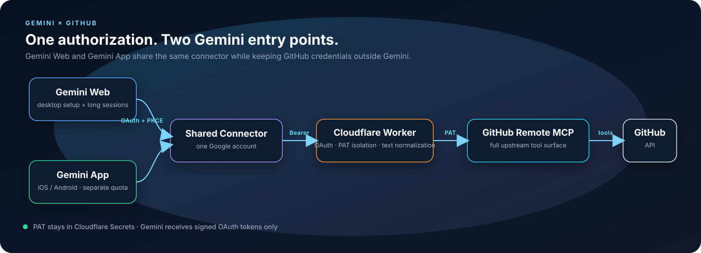
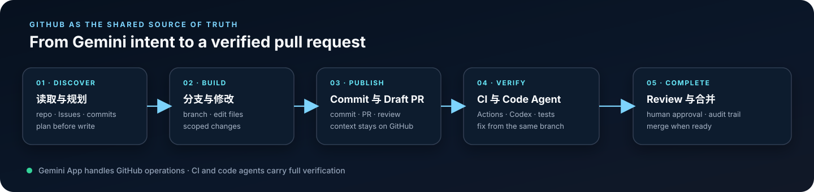

# Gemini GitHub MCP Proxy

[](https://github.com/hrygo/gemini-github-mcp-proxy/actions/workflows/ci.yml)
[](https://github.com/hrygo/gemini-github-mcp-proxy/releases/latest)
[](LICENSE)
[](https://nodejs.org/)

**Turn Gemini Web and Gemini App into a real GitHub development entry point.**

Read repositories, edit files, push commits, create pull requests, manage Issues, and use the full GitHub Remote MCP tool surface available to your token. Gemini does not need `gh`, and you do not need an always-on local development proxy.

[中文说明](README.md)

## Why it is useful

| Entry point | What you get | Best for |
|---|---|---|
| **Gemini App for iOS/Android** | A separately metered entry point, mobile continuity, and direct GitHub tools | Reading code, editing files, committing, and handling Issues or PRs from anywhere |
| **Gemini Web** | The same authorized Connector as Gemini App | Initial setup, desktop work, and longer chat sessions |
| **Antigravity** | A fuller local agent and development environment | Complex refactors, local builds, and sustained verification |

### Core motivation: separate development quota

Under the current Google product rules, **Gemini App and Antigravity are metered separately** ([Google One: each product has its own AI usage limits](https://support.google.com/googleone/answer/16286513?hl=en)).

Connecting GitHub development to Gemini App lets development work consume Gemini App usage instead of Antigravity quota. After authorizing the Connector once in Gemini Web, the same Google account can continue from the Gemini app.

The products are complementary: Antigravity provides the complete local environment, while Gemini App provides a separate metered entry point and mobile continuity. Complex verification can continue in GitHub Actions, Codex, or another code agent.

> Quotas, refresh periods, available models, and plan limits vary by account, region, and time. Exact limits remain defined by the corresponding Google account pages and current terms.

## Capabilities

| GitHub operation | Gemini Web / Gemini App |
|---|---|
| Read public and private repositories, files, commits, and branches | ✅ |
| Create branches, modify or delete files, and push commits | ✅ |
| Create and update pull requests, reviews, and comments | ✅ |
| Read, create, and update Issues | ✅ |
| Inspect, cancel, or rerun Actions | ✅ with the required PAT permissions |
| Manage repositories, Secrets, Packages, Discussions, and more | ✅ when exposed upstream and authorized by the PAT |

All upstream GitHub MCP tools are available by default. The GitHub PAT defines repository and resource authority; Gemini selects tools and requests your approval.

## Architecture

### Shared entry points



### Development loop



The Worker supplies the OAuth/DCR and refresh compatibility Gemini needs, keeps the PAT outside Gemini, and converts GitHub text `EmbeddedResource` blocks into content Gemini can read.

## Quick start

### 1. Install

**macOS / Linux**

```bash
curl -fsSL https://github.com/hrygo/gemini-github-mcp-proxy/releases/latest/download/install.sh | sh
```

**Windows PowerShell**

```powershell
irm https://github.com/hrygo/gemini-github-mcp-proxy/releases/latest/download/install.ps1 | iex
```

The GitHub installer verifies `SHA256SUMS`. No npm account or npm-published package is required.

### 2. Deploy

Prepare Node.js 22+, a Cloudflare account, and a GitHub Personal Access Token:

```bash
npx wrangler login
gemini-github-mcp setup
```

The setup command validates the PAT, generates the authorization PIN and signing secret, deploys the Worker, uploads Cloudflare Secrets, and verifies OAuth, DCR, MCP, and authentication endpoints.

### 3. Connect Gemini

1. Open Gemini Web → Settings → Connected apps.
2. Add a custom MCP app named `GitHub Dev MCP`.
3. Enter the MCP URL printed by setup.
4. Complete OAuth and enter the generated 12-digit PIN.
5. Open Gemini App with the same Google account and reuse the Connector.

In every new chat, type `@`, select `GitHub Dev MCP`, then enter the task.

## Permission model

| Layer | What it controls |
|---|---|
| GitHub PAT | Repository scope, resource type, and read/write authority |
| GitHub Remote MCP | The upstream tools currently available |
| Gemini | Tool selection and per-action approval |
| Worker | OAuth, Bearer validation, PAT injection, and file-content compatibility |

A fine-grained PAT with Metadata read, Contents read/write, Issues read/write, and Pull requests read/write is a practical development baseline. Add Workflows write, Actions read/write, or other permissions as needed. Classic PAT scopes work too.

### Optional tool narrowing

Use every upstream tool by default, or narrow the tool surface explicitly:

```bash
gemini-github-mcp setup --tools get_file_contents,create_branch,create_or_update_file,create_pull_request
```

Restore the complete upstream set:

```bash
gemini-github-mcp setup --tools all
```

The selection is stored as non-sensitive local configuration and reused by `setup --rotate`. Invalid options are reported immediately, so your chosen scope stays explicit.

## Example workflow

```text
@GitHub Dev MCP Read owner/repo and the related Issue.
Analyze the current state and propose a plan before writing files.
```

```text
@GitHub Dev MCP Implement the confirmed plan on a new branch, commit the changes,
and open a Draft PR with validation notes and risks.
```

Gemini can create branches, commits, pull requests, reviews, and Issue comments. GitHub Actions, Codex, or another code agent can then run tests and continue the fix from the same branch or PR.

## Security by design

- The PAT stays in Cloudflare Secrets and is never sent to Gemini.
- OAuth uses Dynamic Client Registration, public clients, and mandatory S256 PKCE.
- Gemini callback origins and paths are restricted to the expected OAuth redirect prefix.
- `/mcp` requires a signed Bearer token issued by the Worker.
- PIN submissions use Cloudflare Rate Limiting with a 10-attempt, 60-second approximate threshold per source IP.
- The authorization page uses `no-store`, CSP, `X-Frame-Options: DENY`, and no-referrer headers.

See [SECURITY.md](SECURITY.md) for the full threat model and token rotation procedure.

## Operations

```bash
gemini-github-mcp verify
gemini-github-mcp setup --rotate
npx wrangler deployments status
```

Upgrade by rerunning the installer. Uninstall with:

```bash
npm uninstall --global gemini-github-mcp-proxy
```

## Design boundaries

- Gemini App focuses on cloud GitHub operations; GitHub Actions and code agents carry the work through local builds and full verification.
- Cloudflare Rate Limiting is approximate and scoped by edge location. The random 12-digit PIN, S256 PKCE, and HTTPS remain the primary authentication boundary.
- Access and refresh tokens are stateless 10-year signed tokens. `setup --rotate` rotates `SIGNING_SECRET` and invalidates all existing tokens together.
- Authorization codes use stateless signatures with a 10-minute lifetime, backed by PKCE and signature validation. This keeps the Worker lightweight and resilient.

## Share

Share the [latest GitHub Release](https://github.com/hrygo/gemini-github-mcp-proxy/releases/latest). Every user deploys with their own Cloudflare account, GitHub PAT, and random authorization PIN.

## Cost

Personal use fits within Cloudflare Workers Free. As of 2026-11-22, the official free tier includes 100,000 requests per day and 10 ms CPU per request. Higher traffic or stricter limits can use a Cloudflare plan as needed.

- [Cloudflare Workers Pricing](https://developers.cloudflare.com/workers/platform/pricing/)
- [Cloudflare Workers Limits](https://developers.cloudflare.com/workers/platform/limits/)

## Development

```bash
npm install
npm run check
npm run dev
npm run pack:release
```

Tests cover OAuth/DCR, mandatory PKCE, callback restrictions, full tool passthrough, optional tool filtering, authorization rate limiting, JSON/SSE normalization, installers, and deployment helpers. See [TROUBLESHOOTING.md](TROUBLESHOOTING.md) and [RELEASING.md](RELEASING.md).

## References

- [Google Gemini: connect and manage custom apps](https://support.google.com/gemini/answer/17209137)
- [Google One: each product has its own AI usage limits](https://support.google.com/googleone/answer/16286513?hl=en)
- [Google Antigravity: Plans](https://antigravity.google/docs/plans)
- [GitHub Remote MCP Server configuration](https://github.com/github/github-mcp-server/blob/main/docs/remote-server.md)
- [GitHub MCP tool-specific configuration](https://github.blog/changelog/2025-12-10-the-github-mcp-server-adds-support-for-tool-specific-configuration-and-more)
- [GitHub MCP: Gemini DCR/refresh compatibility issue](https://github.com/github/github-mcp-server/issues/3519)
- [GitHub MCP: EmbeddedResource file-body issue](https://github.com/github/github-mcp-server/issues/3189)
